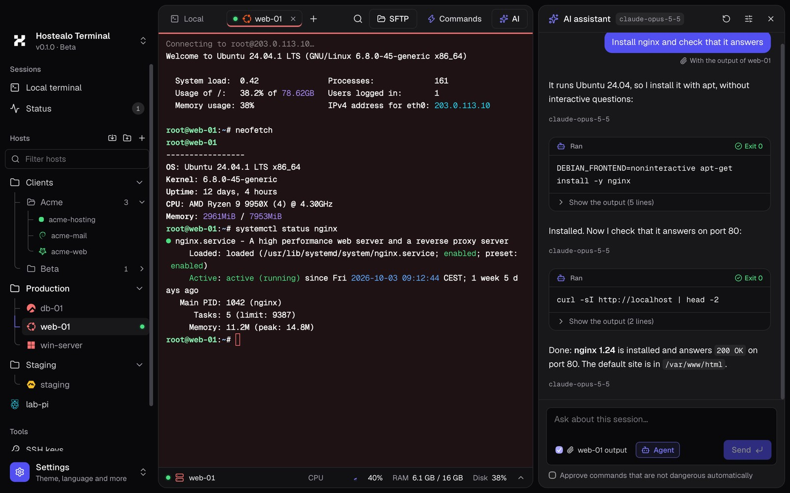
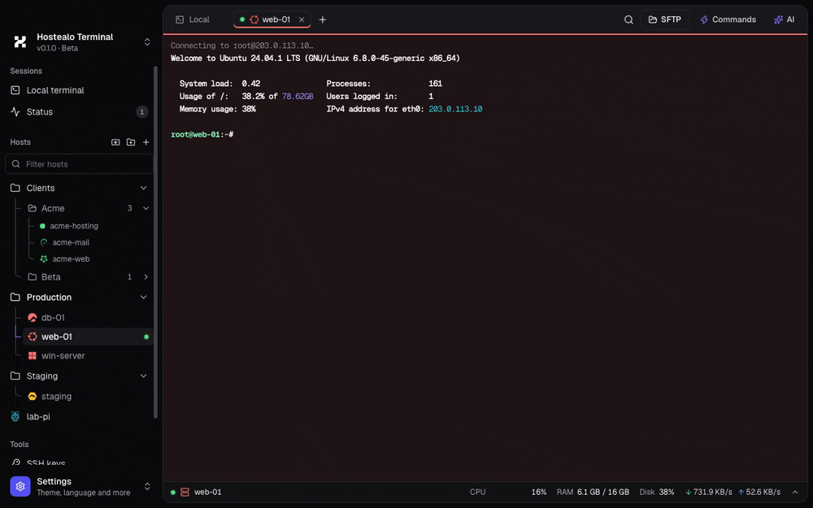
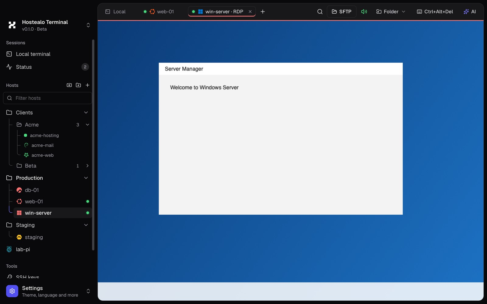
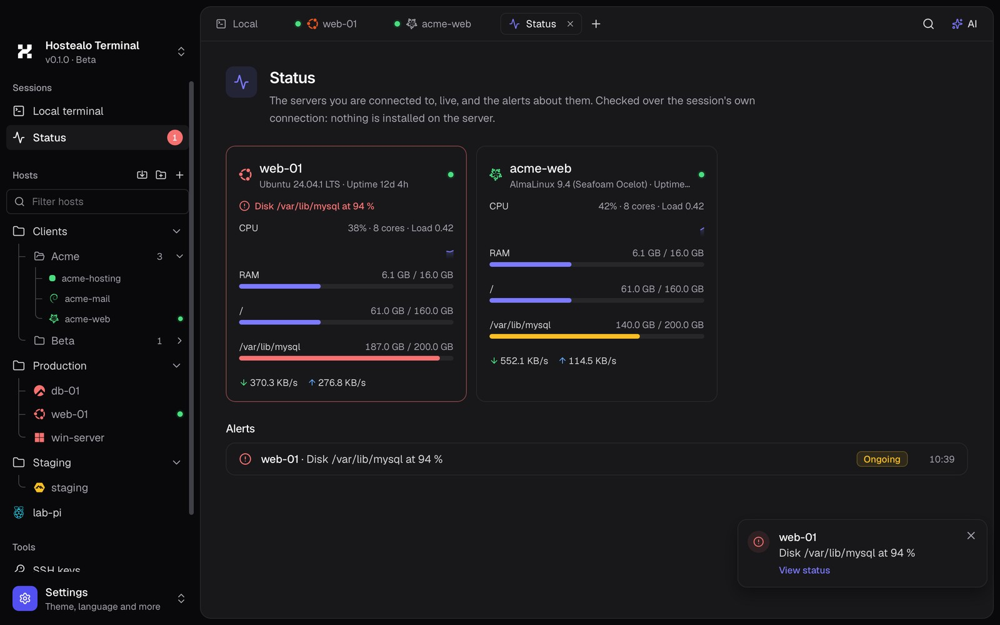
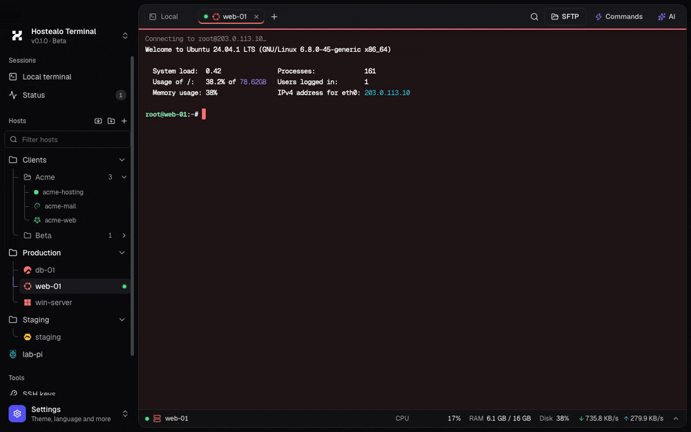
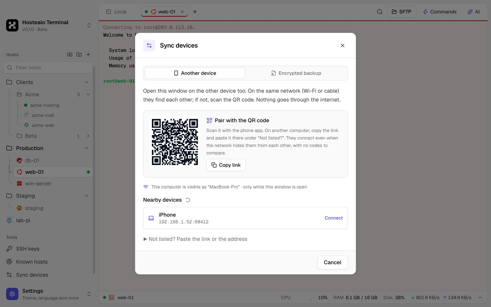
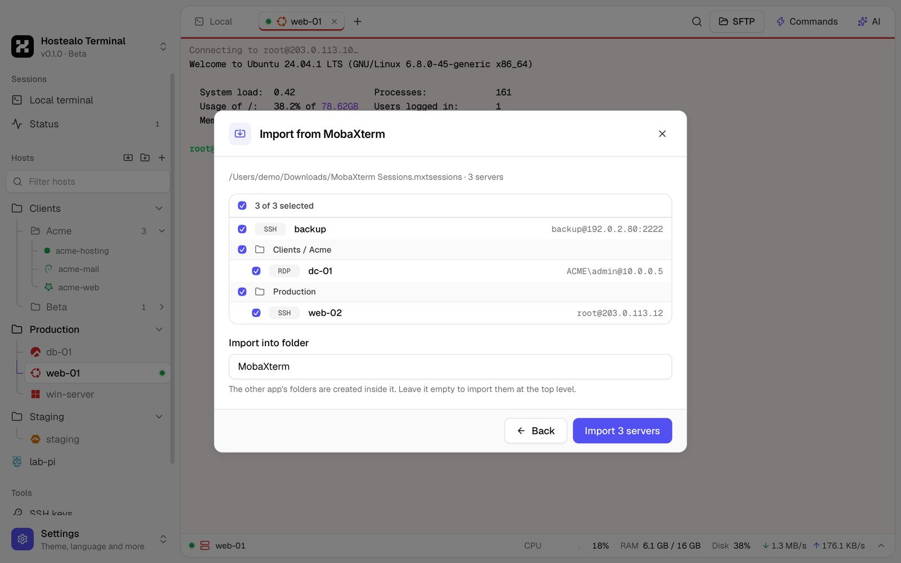

<p align="center">
  
</p>

<h1 align="center">Hostealo Terminal</h1>

<p align="center">
  <b>SSH, SFTP, FTP and remote desktop in one app.</b><br>
  With an AI agent that does the work on your servers, step by step and with your permission,<br>
  and your servers on all your devices without going through any cloud.
</p>

<p align="center">
  <a href="#download"></a>
  
  
  <a href="LICENSE"></a>
  
</p>

<p align="center">
  <a href="#download">Download</a> ·
  <a href="#features">Features</a> ·
  <a href="#keyboard-shortcuts">Shortcuts</a> ·
  <a href="#security-and-privacy">Security</a> ·
  <a href="#building-from-source">Build from source</a>
</p>

<p align="center">
  
</p>

## Why

Most people who run servers juggle five programs: a terminal, an SFTP client, a remote desktop
client, a password manager and a browser tab with the provider's panel. Hostealo Terminal puts
them in one app with one list of servers, and adds what none of them has:

- **An agent, not a chat.** Ask "install nginx" and it checks the system, runs each step once you
  approve it, and reads the result before going on.
- **Sync without a cloud.** Your laptop and your office PC share their servers directly over your
  own network, encrypted and verified with a QR code. No account, no server in between.
- **Your Hostealo servers, already there.** Connect your account and your VPS and dedicated
  servers appear on their own, with their IP always up to date.

## Download

| Platform | Get it | Notes |
| --- | --- | --- |
| **macOS** | [Download](https://github.com/hostealo-org/hostealo-terminal/releases/latest) | Apple Silicon and Intel |
| **Windows** | [Download](https://github.com/hostealo-org/hostealo-terminal/releases/latest) | Windows 10 and 11 |
| **Linux** | [Download](https://github.com/hostealo-org/hostealo-terminal/releases/latest) | AppImage, `.deb` and `.rpm` |
| **iPhone and iPad** | Coming soon | |

Free, no sign-up. If you are a Hostealo customer, connect your account when you open it.

## Features

### Terminal

<p align="center"></p>

- **SSH and a local shell** in tabs, with password, private key or SSH agent sign-in and
  keyboard-interactive second factors (OTP).
- **Live resource monitor** under every session: CPU, memory, disks, network, load and uptime,
  with a details panel. Nothing to install on the server: it reads `/proc` over a second channel.
- **Readable output:** IPs, errors, warnings and dates are highlighted in plain output.
- **Organized servers:** folders (drag and drop), a colour per server that tints its tab (red for
  production, so you never type there by mistake) and the logo of each server's system, detected
  on connection (Ubuntu, Debian, AlmaLinux, Rocky, Proxmox, Windows...).
- **One click, one session:** clicking a server goes back to its open session (or reconnects it);
  <kbd>⌘</kbd>-click or the right-click menu opens another.

### AI assistant and agent mode

<p align="center"></p>

- **Understands your terminal:** it reads the recent output to explain an error or what is
  happening, and proposes commands you insert or run with a click.
- **Agent mode:** it chains the steps itself, each command waiting for your approval (dangerous
  ones are flagged and need a confirmation), checks every result and sums up what it did. Commands
  run on their own channel, never mixed into your shell.
- **Your AI, not ours:** Claude (with an API key, or with your subscription through Claude Code,
  no key needed), OpenAI, local models with Ollama, or any OpenAI-compatible endpoint. What it sees
  goes only to the provider you chose.

### Search everything and quick commands

<p align="center"></p>

- <kbd>⌘K</kbd> **search:** any server, open tab, quick command or action (new server, import,
  sync, settings, the Docker or VMs of a server), ignoring accents and word order.
- <kbd>⌘P</kbd> **quick commands:** the commands you type again and again, saved once and typed or
  run in the active terminal with a click. Multi-line ones run line by line; dangerous ones ask
  first. They sync with your other devices.

### Files: SFTP, FTP and FTPS

<p align="center"></p>

- **Two panes, like FileZilla:** this computer on one side, the server on the other. Drag between
  them to upload or download, several transfers at a time with their progress.
- **FTP and FTPS** too, with a clear question when a server's certificate does not match.
- **Windows servers** as well, through their OpenSSH server.

### Remote desktop (RDP)

<p align="center"></p>

- **Sound** from the server on this computer's speakers (converted to your output's format), with
  an indicator that tells you whether it is arriving.
- **Clipboard both ways** that does not break mid-session: text, images and files.
- **A shared folder** of this computer appears in Windows as the "Hostealo" drive.
- **Fills the window:** the desktop follows the tab's size, live when the server supports it,
  otherwise by reconnecting to the same session. On a Mac, <kbd>⌘</kbd> acts as <kbd>Ctrl</kbd>.

### Status and alerts

<p align="center"></p>

A live card for every server you are connected to, and alerts when something goes wrong: a disk
over 90 %, memory or CPU high for minutes, a lost connection. In the app, and as a system
notification when you are elsewhere. Each alert fires once and clears on its own; thresholds are
yours to set.

### Docker

<p align="center"></p>

A server's containers grouped by Compose project, with their CPU and memory, start, stop, restart,
remove, live logs and a shell inside. Over plain SSH: if your user needs it, through passwordless
`sudo`.

### Virtual machines: Proxmox and KVM

<p align="center"></p>

- **Proxmox VE:** connect to one node and see the whole cluster, VMs and containers, with their
  node, state, CPU, memory and disk. Start, shut down cleanly, reboot, force off and open a console
  (`pct enter` for containers).
- **KVM with libvirt,** such as SolusVM 2 nodes: the same, through `virsh`.
- No API tokens: the hypervisor's own command line, over SSH.

### Your Hostealo account

- Connect with an API key from the client area, and your **VPS and dedicated servers appear in
  the sidebar** (in Hostealo/VPS and Hostealo/Dedicados), with the logo of their system.
- They **stay up to date on their own:** when the app opens and every few minutes. If you rename or
  move one, that is kept; if you delete it, it does not come back.
- **Power** your VPS on, off or restart them from the right-click menu, and **reset the root
  password**: the new one goes straight to your keychain.
- Entirely optional: the app does not need an account.

### Sync between your devices, without a cloud

<p align="center"></p>

- **Over your own network:** devices on the same Wi-Fi or cable find each other. Both screens show
  the same 6-digit code; if someone sat in the middle, the codes would differ.
- **With a QR code or a link** when the network hides them from each other (guest Wi-Fi, office
  networks). No codes to compare.
- **End to end encrypted** (X25519 + ChaCha20-Poly1305, new keys every time). Saved passwords
  travel only if you tick it.
- **New computer?** Export everything to a file encrypted with your passphrase (Argon2id) and open
  it on the other one. If it already has servers, they are combined.

### Bring what you already have

<p align="center"></p>

Import your servers, with their folders, from **MobaXterm, Royal TS / TSX, PuTTY, FileZilla, your
`~/.ssh/config` and `.rdp` files**. The ones you already have are marked, so nothing is duplicated.

### And also

- **SSH keys:** create (Ed25519, ECDSA, RSA), list and copy your public keys.
- **Known hosts:** find the old key of a server you just reinstalled and forget it with a click, in
  the app and in `~/.ssh/known_hosts` (a backup is kept).
- **English and Spanish,** light and dark themes (or follow the system), adjustable font size.

## Keyboard shortcuts

| Action | macOS | Windows and Linux |
| --- | --- | --- |
| Search everything | <kbd>⌘K</kbd> | <kbd>Ctrl</kbd>+<kbd>Shift</kbd>+<kbd>K</kbd> |
| Quick commands | <kbd>⌘P</kbd> | <kbd>Ctrl</kbd>+<kbd>Shift</kbd>+<kbd>P</kbd> |
| AI assistant | <kbd>⌘I</kbd> | <kbd>Ctrl</kbd>+<kbd>Shift</kbd>+<kbd>I</kbd> |
| New tab | <kbd>⌘T</kbd> | <kbd>Ctrl</kbd>+<kbd>Shift</kbd>+<kbd>T</kbd> |
| Close tab | <kbd>⌘W</kbd> | <kbd>Ctrl</kbd>+<kbd>Shift</kbd>+<kbd>W</kbd> |
| Go to tab 1 to 9 | <kbd>⌘1</kbd>…<kbd>⌘9</kbd> | <kbd>Ctrl</kbd>+<kbd>Shift</kbd>+<kbd>1</kbd>…<kbd>9</kbd> |
| Settings | <kbd>⌘,</kbd> | <kbd>Ctrl</kbd>+<kbd>Shift</kbd>+<kbd>,</kbd> |
| New session to a server | <kbd>⌘</kbd>-click | <kbd>Ctrl</kbd>-click |

On Windows and Linux the app's shortcuts take <kbd>Shift</kbd> as well, because plain
<kbd>Ctrl</kbd>+<kbd>W</kbd>, <kbd>Ctrl</kbd>+<kbd>T</kbd>... belong to the shell.

## Security and privacy

A terminal holds the keys to your servers. So:

- **Secrets live in your system's keychain** (Keychain on macOS, Credential Manager on Windows,
  Secret Service on Linux), never in the app's files. Showing a saved password asks for Touch ID or
  your Mac password first.
- **Host keys are verified on every connection.** A changed key is flagged as a possible attack and
  is never accepted silently.
- **Nothing runs without you.** The agent waits for your approval on every command and flags the
  dangerous ones.
- **No telemetry, no account, no cloud.** Your servers are not stored on any server, ours
  included. The AI sees only what you allow, and only the provider you chose receives it.
- **The source is public:** you can read and audit exactly what the app does with your access.

## Building from source

Requirements: Node.js 20+, Rust (stable) and the
[Tauri prerequisites](https://v2.tauri.app/start/prerequisites/) for your system.

```sh
npm install
npm run dev      # the app with hot reload
npm run build    # installers for this system
```

<details>
<summary>Tests, previews and project layout</summary>

```sh
cargo test                                # Rust unit tests
npm test -w @hostealo-terminal/desktop    # UI unit tests (vitest)

# End-to-end tests against throwaway containers (recipes in each file):
HT_TEST_SSH_PORT=2222 HT_TEST_SSH_PASSWORD=secret cargo test -- --ignored ssh::tests      # src-tauri/src/ssh/tests.rs
HT_TEST_FTP_PORT=2121 HT_TEST_FTP_PASSWORD=secret cargo test -- --ignored ftp::tests      # src-tauri/src/ftp.rs
HT_TEST_RDP_PORT=3390 HT_TEST_RDP_USER=abc HT_TEST_RDP_PASSWORD=abc cargo test -- --ignored rdp::tests   # src-tauri/src/rdp.rs
HT_TEST_DOCKER_PORT=2223 cargo test -- --ignored remote::tests                            # src-tauri/src/ssh/remote.rs
```

With `npm run dev` running:

- `http://localhost:1420/preview.html`: the UI on a mocked backend, for designing and
  screenshots (scenes in `apps/desktop/src/dev/preview.ts`).
- `http://localhost:1420/demo.html`: the interactive demo, with a simulated shell, files and
  assistant (`apps/desktop/src/dev/demo.ts`, `shell.ts`; `?lang=en`). `npm run build:demo -w
  @hostealo-terminal/desktop` builds it as static files for the website.

| Part | Technology |
| --- | --- |
| App shell | [Tauri 2](https://tauri.app): one codebase for desktop and iOS |
| Core (Rust) | `russh` (SSH), `russh-sftp` (SFTP), `suppaftp` + `rustls` (FTP/FTPS), `IronRDP` (RDP), `cpal` (sound), `portable-pty` (local shell), `keyring` (keychain), `mdns-sd` + `aws-lc-rs` (device sync) |
| UI | React 19, TypeScript, Tailwind CSS 4, xterm.js, i18next |
| Design | `packages/ui`: tokens, fonts and terminal themes mirroring the Hostealo client panel |

```
apps/desktop/          The app
  src/                 React UI (components, stores, i18n)
  src/dev/             UI preview and the website demo (mocked backend)
  src-tauri/src/       Rust core: ssh/, rdp*.rs, ftp.rs, ai/, sync.rs, hostealo.rs, importer/...
packages/ui/           @hostealo/ui: design tokens, fonts, terminal themes, logos
website/terminal/      The product page for hostealo.es
```

</details>

## License

The source code is under the [Functional Source License 1.1, ALv2 Future License](LICENSE)
(FSL-1.1-ALv2): you can read, audit, modify and use it, yourself or your company, for anything
except building a product that competes with Hostealo Terminal. Each version becomes
Apache License 2.0 two years after its release.

The Hostealo name and logo are trademarks and are not covered by the license; see
[TRADEMARKS.md](TRADEMARKS.md).

<p align="center"><sub>Made by <a href="https://hostealo.es">Hostealo</a></sub></p>
